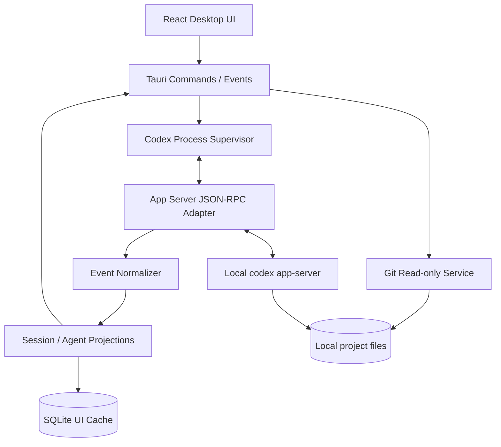

# Orbita (принятое название)
# Codex Visual Workspace

> **Статус:** Draft / ready for implementation planning  
> **Версия спецификации:** 0.1  
> **Дата:** 2026-11-19  
> **Платформа MVP:** Windows 11 (Windows 10 — по результатам тестирования)  
> **Модель распространения:** open source, local-first  
> **Рабочее название:** Codex Visual Workspace (окончательное название и проверка торговых марок — отдельно)

---

## 1. Executive summary

**Codex Visual Workspace** — десктопное приложение для работы с локальным Codex через привычный интерфейс чатов и проектов, с наблюдаемостью за встроенной мультиагентной работой Codex.

Пользователь открывает приложение, выбирает локальный проект, запускает/продолжает сессию Codex, пишет сообщения, выбирает доступную модель и наблюдает за выполнением. Если Codex самостоятельно запускает дочерних агентов, приложение показывает их появление, статус, действия, вызовы инструментов, результаты и связи с родительской сессией — **в пределах информации, предоставляемой протоколом Codex**.

**Ключевой принцип: Codex оркестрирует агентов; приложение визуализирует происходящее и предоставляет безопасные пользовательские действия.**

### 1.1 Основные цели

1. Сделать ежедневную работу с Codex удобнее, чем в терминале, не создавая полноценную IDE.
2. Предоставить чаты, проекты, историю и быстрые переключения между контекстами.
3. Сделать деятельность Codex и его субагентов наблюдаемой: timeline, статусы, вызовы инструментов, диффы, ошибки и запросы разрешений.
4. Сохранить существующую семантику и оркестрацию Codex без собственного агентного планировщика.
5. Обеспечить предсказуемую работу локального приложения на Windows и, в дальнейшем, WSL.
6. Оставить расширяемые точки для MCP, skills, профилей запуска и дополнительных UI-возможностей.

### 1.2 Не-цели

- Собственный orchestrator, scheduler или task DAG engine.
- Принудительное создание/назначение задач дочерним агентам вне интерфейсов Codex.
- Альтернативный runtime моделей или копия Codex harness.
- Полнофункциональный редактор кода, LSP, debugger или замена Cursor / VS Code.
- Подключение к произвольному уже запущенному терминальному процессу `codex` (**вариант B исключён**).
- Remote agents, SSH-компьютеры, распределённая оркестрация и мобильный клиент в MVP.
- Отображение скрытого внутреннего chain-of-thought: только реально доступные summaries, события и действия.

---

## 2. Продуктовая концепция

### 2.1 Основной сценарий (выбран вариант A)

1. Пользователь запускает **Codex Visual Workspace**.
2. Приложение обнаруживает установленный `codex` и проверяет версию/доступность App Server.
3. Пользователь выбирает папку проекта.
4. Приложение **само запускает `codex app-server`**, устанавливает локальное соединение и инициирует протокольный handshake.
5. Пользователь создаёт новый чат или открывает ранее сохранённый thread и отправляет задание.
6. Codex самостоятельно выполняет работу и при необходимости создаёт субагентов.
7. Приложение показывает поток ответов, события инструментов, запросы разрешений, визуализацию дочерних агентов и изменения файлов.
8. Пользователь может принять/отклонить разрешение, остановить доступный turn, написать уточнение в чат или открыть Git diff.
9. При переключении чатов и проектов приложение сохраняет навигационное состояние. При повторном запуске восстанавливает доступную историю Codex.

**Важно:** запуск через приложение — основной поддерживаемый путь. Импорт/подключение к живой чужой CLI-сессии не требуется.

### 2.2 UX-принцип

**Chat-first, observability-second.** Основное рабочее пространство — обычный чат. Агентная активность не заменяет беседу, а отображается как компактная сводка, которую можно раскрыть до детального графа/таймлайна/лога.

### 2.3 Пользовательские истории

- Как разработчик, я хочу быстро переключаться между проектами и чатами, не меняя рабочий каталог в терминале.
- Я хочу выбирать доступную модель/параметры на новом чате или turn там, где это разрешает Codex.
- Я хочу видеть, что основной агент создал 3 субагентов, кому поручены задачи и кто всё ещё работает.
- Я хочу открыть отдельного субагента и прочитать доступные сообщения, команды, ошибки и результаты.
- Я хочу видеть просьбы об approval в одном месте и подтверждать только осознанные действия.
- Я хочу видеть реальные изменения кода и открывать изменённые файлы во внешнем редакторе.
- Я хочу возобновить чат после перезапуска приложения, если Codex сохранил thread.
- Я хочу понимать, что UI *не знает* о ходе работы, а не видеть придуманные статусы.

---

## 3. Функциональный scope

### 3.1 MVP (P0)

| ID | Функция | Ожидаемое поведение |
|---|---|---|
| F01 | Onboarding | Проверка установки Codex, версия, наличие авторизации, понятные ошибки и инструкции |
| F02 | Local App Server | Запуск/остановка управляемого процесса, handshake, обработка stdout/stderr, crash recovery |
| F03 | Projects | Добавление/удаление папок из списка UI; последнее открытое рабочее пространство |
| F04 | Chats | Список threads, новый thread, переключение, продолжение доступной истории |
| F05 | Chat UI | Markdown, code blocks, streaming, команды и результаты инструментов |
| F06 | Models | Показывать модельный каталог, позволять менять разрешённые настройки согласно API |
| F07 | Activity Timeline | Поток событий turn/items, tool calls, stdout-фрагменты, ошибки и завершение |
| F08 | Subagent Overview | Появление/связи/статусы субагентов по фактическим событиям; fallback при отсутствии данных |
| F09 | Agent Details | Просмотр доступной истории и activity отдельного субагента по его ID, если это допускает протокол |
| F10 | Approvals | Очередь разрешений с контекстом действия и явными approve/deny/cancel, когда доступны |
| F11 | Turn Control | Отправка сообщения, остановка/прерывание turn, если доступно через App Server |
| F12 | Git Diff | Просмотр локальных изменений, список файлов и diff; без автоматического commit/merge |
| F13 | Recovery | Восстановление списка threads и доступной истории после рестарта приложения |
| F14 | Diagnostics | Панель логов приложения/протокола, экспорт очищенного diagnostic bundle |
| F15 | Settings | Путь к Codex, тема, настройки просмотра, конфигурация runtime без раскрытия секретов |

**Мультиагентность — обязательная пользовательская функция MVP**, но её глубина определяется экспериментом с протоколом (раздел 8). Минимальное достижение: достоверная карточка вызова делегирования и связи с агентом; глубокая дочерняя история — при доступности API.

### 3.2 После MVP (P1)

- Граф агента и субагентов с интерактивными узлами, поиском, сворачиванием ветвей.
- Unified attention inbox: approvals, вопросы, сбои, завершённые задачи, требующие просмотра.
- Расширенный MCP Manager: серверы, capabilities, инструменты, подключение и диагностика; без обхода штатных политик Codex.
- Skills Manager: обнаружение, просмотр, создание/редактирование файлов skills с подтверждением пользователя.
- Встроенный терминал (xterm.js + Windows ConPTY / WSL PTY) как *дополнение*, не канал управления Codex.
- Командные палитры, hotkeys, поиск по сессиям, экспорт транскриптов.
- Просмотр/настройка профилей Codex, preview контекста и конфигурации.
- Опциональная WSL-интеграция с отдельной диагностикой окружения.
- Сравнение результатов сессий, снапшоты, расширенное Git review.

### 3.3 Дальше (P2 / исследовать)

- Другие harnesses через адаптеры, если они предоставляют пригодный событийный протокол.
- Необязательные plugins UI и кастомные dashboards.
- Remote App Server через защищённый транспорт.
- Прозрачная передача инструкции конкретному субагенту **только через официально поддерживаемое API**; иначе — сообщение главному агенту.
- Графическое отображение workflows, созданных самим Codex, а не собственный исполнитель workflow.

---

## 4. UX и экраны

### 4.1 Основной layout

```text
┌──────────────────────────────────────────────────────────────────────────────────┐
│ Project: backend-api       Chat: Auth refactor      Model: [available ▼]   ⚙    │
├───────────────────┬────────────────────────────────────┬─────────────────────────┤
│ PROJECTS          │ CHAT                               │ ACTIVITY                │
│ • backend-api     │ User: Refactor auth, use agents     │ Main agent: working     │
│ • frontend        │                                    │ ├─ Research: done       │
│ • infra           │ Codex: I delegated...              │ ├─ Backend: running     │
│                   │                                    │ └─ Test: waiting        │
│ CHATS             │ [Agent activity: 3 agents]          │                         │
│ • Auth refactor   │                                    │ [Details / Timeline]    │
│ • Fix CI          │ [Tool events collapsed]            │                         │
│ • DB migration    │                                    │                         │
│                   │ [Write a message ...]              │                         │
└───────────────────┴────────────────────────────────────┴─────────────────────────┘
```

Правая панель — сворачиваемая; на маленьких окнах может быть вкладкой. UI не должен требовать одновременно видеть чат и граф.

### 4.2 Экраны

1. **Home / Projects** — список локальных проектов, быстрый запуск и последние чаты.
2. **Project Workspace** — список чатов, основной чат, активность.
3. **Agent Inspector** — ID, родитель, текущее состояние, исходное поручение, инструменты, доступная история, timestamps.
4. **Activity / Timeline** — фильтры по агенту, типу события, времени и ошибкам.
5. **Diff Viewer** — working tree, изменённые файлы, сравнение, переход в редактор.
6. **Approvals Inbox** — запросы с чётким источником, командой/файлом, scope и типом разрешения.
7. **Settings / Diagnostics** — Codex path/version, runtime health, transport, импорт и экспорт диагностик.

### 4.3 Состояния UX

Для каждого чата: `idle`, `starting`, `running`, `awaiting_approval`, `completed`, `failed`, `interrupted`, `disconnected`, `unknown`. Это **UI-проекции**, а не новая система исполнения.

Для субагента: `observed`, `active`, `waiting`, `completed`, `failed`, `closed`, `unknown` — отображать только при наличии соответствующего источника; при неоднозначности показывать `unknown` / «последнее событие ...».

### 4.4 Правила отображения

- Любой видимый факт про агентскую работу должен быть подтверждён событием/историей Codex.
- Нельзя делать вывод «completed» из отсутствия событий или из того, что исчез анимированный индикатор.
- Если история дочернего агента недоступна, отображать «Нет доступных подробностей», а не пустую правдоподобную переписку.
- Reasoning summaries отображаются только когда предоставлены; скрытые рассуждения не реконструируются.
- Входящие approvals должны оставаться заметными при переключении чатов.
- Граф и таймлайн — разные представления **одного event/state projection**.

---

## 5. Архитектура

### 5.1 Рекомендуемый стек

| Слой | Решение | Причина |
|---|---|---|
| Desktop shell | **Tauri 2** | Десктопная интеграция, небольшой пакет, native process control |
| UI | **React + TypeScript + Vite** | Скорость разработки и экосистема |
| UI state | Zustand + TanStack Query | Локальное реактивное состояние и запросы |
| Styling | Tailwind CSS + собственные UI primitives | Консистентный интерфейс |
| Persistence | SQLite (через Rust backend) | Локальные проекты, предпочтения, индекс событий |
| Codex integration | `codex app-server` по локальному stdio JSON-RPC | Официальный lifecycle/streaming/approvals канал |
| Runtime supervisor | Tauri/Rust backend | Запуск процесса, stdout/stderr, завершение, health/restart |
| Diff | Git CLI (локально, read-only в MVP) | Максимальная совместимость |
| Graph (P1) | React Flow / XYFlow | Интерактивная карта субагентов |
| Logs | Structured tracing с redaction | Диагностика и воспроизводимость |
| Tests | Vitest, Rust unit tests, Playwright/E2E там, где возможно | Проверка протокола и UX |

**Альтернатива:** Tauri + отдельный Node sidecar оправдан, если JSON-RPC/typed event adapter существенно быстрее написать на TypeScript. Не вводить sidecar без необходимости. Для MVP предпочтителен один supervisor на Rust и типизированные UI DTO.

### 5.2 Компоненты



### 5.3 Границы ответственности

**Codex App Server / harness:**
- Модели, контекст беседы, выполнение tool calls, взаимодействие с MCP.
- Создание/коммуникация/ожидание/закрытие субагентов.
- Фактические approval policies, execution sandbox, runtime capabilities.

**Приложение:**
- UX, навигация, поиск, фильтры, открытие проектов и история представлений.
- Запуск и наблюдение за процессом App Server.
- Коммуникация с API, выполнение разрешённых действий пользователя.
- Индексация наблюдаемых событий, отображение состояния и Git diff.

**Никогда не дублировать:**
- Агентный task scheduler, агентную память, скрытую системную логику Codex.
- Внутренний протокол коммуникации агентов поверх официальной поверхности.

### 5.4 Организация процесса

Для первой версии допускается **один управляемый App Server на приложение**, обслуживающий несколько threads/projects, если это подтверждено API и тестами. Если version/isolated-environment constraints требуют иного — supervisor создаёт по одному серверу на runtime profile. Это решение не должно быть жёстко зашито в UI.

Lifecycle: `stopped → spawning → initializing → ready → degraded → stopping/failed`.

Обязательные меры: distinct process handles, stderr capture, bounded log buffer, timeouts, корректная очистка pending RPC, защита от zombie processes, graceful shutdown + forced kill при необходимости. При крэше не отправлять новые команды до reconciliation.

### 5.5 Windows и WSL

- **MVP:** нативный Windows-процесс `codex`, проекты на доступных локальных путях.
- Путь к executable определять через настройку и обнаружение в PATH; проверять version/capabilities, не предполагать одинаковую установку у всех.
- При запуске передавать `cwd` и окружение явно, без shell-интерполяции пользовательских путей; пути с пробелами должны работать.
- Разделять Windows/WSL file paths и окружения; **WSL — отдельный P1 backend**, а не автоматическая конвертация путей regex-ами.
- Не хранить credentials: использовать существующую авторизацию Codex и предлагаемые официальные механизмы.

---

## 6. Codex App Server integration

### 6.1 Источник контракта

Источники истины: официальный репозиторий и установленная версия App Server; проверять актуальную схему на старте разработки:

- [Codex App Server README](https://github.com/openai/codex/blob/main/codex-rs/app-server/README.md)
- [Codex repository](https://github.com/openai/codex)
- [Codex as a platform](https://developers.openai.com/blog/codex-as-a-platform)

App Server — **не** Agents API и **не** собственный прокси к OpenAI API. Не смешивать эти интерфейсы. Имена, поля, lifecycle и capabilities необходимо перепроверить на целевой pinned-версии Codex.

### 6.2 Необходимые операции (контракт-ориентированно)

| Категория | Требование | Примеры API (подтвердить схему) |
|---|---|---|
| Initialization | Handshake, поддерживаемые capabilities | `initialize` |
| Thread lifecycle | Создать, показать, загрузить/продолжить | `thread/start`, `thread/list`, `thread/read`, `thread/resume` |
| Turn lifecycle | Отправить input, остановить, получить конец | `turn/start`, `turn/interrupt`, notifications |
| History | Постранично читать items | `thread/items/list` (если доступно в целевой версии) |
| Models | Список доступных моделей/параметров | `model/list` |
| Approval | Получить запрос, ответить через соответствующий request | approval requests/responses согласно схеме |
| MCP | Состояние подключений (P1) | `mcpServerStatus/list` и релевантные методы |
| Agent events | Делегирование/сообщения/вызовы инструментов | item type/event variants выбранной версии |

**Правило:** список выше — ориентир для реализации, не готовые payloads. Не кодировать предположительные поля из этого документа без проверки OpenAPI/генерируемой схемы/реальных сообщений.

### 6.3 Transport

- Локальный stdio, один JSON-RPC adapter с корреляцией request ID → response.
- Двунаправленные сообщения: server → client могут содержать не только notifications, но и запросы approval, на которые нужно ответить.
- Не блокировать чтение stdout во время ожидания ответа: поток событий и RPC requests должны обрабатываться конкурентно.
- Сохранять исходный порядок в пределах одного транспорта; не предполагать глобальный порядок между несколькими процессами.
- Логировать unknown messages для диагностики, не падать при появлении нового event variant.
- Обрабатывать request timeouts, cancellation и reconnect/restart с повторным чтением истории.

### 6.4 Agent event model

Сначала работать с реальными item variants и notifications целевой версии. **Не утверждать, что каждый subagent гарантированно имеет отдельный читаемый thread, что доступны все промежуточные сообщения, или что состояние можно получить через единый API.**

Нормализованные события внутреннего UI:

```ts
// Концептуальный контракт приложения, НЕ схема Codex API.
type ObservedEvent = {
  id: string;                    // локальный стабильный ключ, может быть составным
  source: 'app-server';
  runtimeId: string;
  threadId?: string;
  turnId?: string;
  agentId?: string;
  parentAgentId?: string;
  itemId?: string;
  kind: string;                  // 'tool.started', 'agent.spawned', ...
  time?: number;                 // timestamp от источника, если доступен
  observedAt: number;           // время наблюдения UI
  payload: unknown;             // типизируется по variant
  provenance: 'direct' | 'derived';
};
```

Для agent graph:

```ts
type AgentNode = {
  id: string;
  parentId?: string;
  threadId?: string;
  title: string;                 // label из события или нейтральный fallback
  taskSummary?: string;         // только если передан источником
  status: 'observed' | 'active' | 'waiting' | 'completed' | 'failed' | 'closed' | 'unknown';
  lastObservedAt?: number;
  evidenceEventIds: string[];
};
```

Операции `spawn_agent`, `send_input`, `wait` и похожие **могут быть наблюдаемыми** как вызовы collaboration tool. Внутренние функции Codex не становятся автоматически командами публичного UI. Никаких собственных синтетических вызовов делегирования.

### 6.5 State projection и восстановление

1. Live event → validation → normalization → dedupe → local projection.
2. UI подписывается на проекцию, а не на сырые строки протокола.
3. При restart/reconnect: получить `thread/list`/`thread/read`/items историю; сопоставить по устойчивым ID, убрать дубликаты.
4. Сохранить last-seen anchors/cursors, если API версии позволяет.
5. При неполной истории явно показывать gaps и degraded state.
6. SQLite содержит **кеш UI**, никогда не замещает Codex как источник истины по выполнению.

### 6.6 Ограничения на reasoning

Отображать только предусмотренные протоколом пользовательские explanations, summaries и trace событий. Не пытаться извлекать скрытый chain-of-thought из внутренних storage/rollout и не заявлять, что показываем «все рассуждения».

---

## 7. Локальные данные

Предлагаемые таблицы SQLite (в деталях могут меняться):

```text
projects(id, path, display_name, created_at, last_opened_at)
chat_ui_state(thread_id, project_id, pinned, last_opened_at, custom_title)
runtimes(id, kind, executable_path, version, last_seen_at)
event_cache(id, runtime_id, thread_id, turn_id, item_id, kind, payload_json, observed_at)
agent_projection(runtime_id, agent_id, parent_id, thread_id, status, last_event_id)
ui_preferences(key, value_json)
```

- Не дублировать в SQLite доступные токены и секреты.
- Хранение сырых событий — **opt-in либо ограниченный ring buffer**, поскольку в них могут быть секреты, исходники и команды.
- Документировать пути хранения, retention, команду очистки кеша и политику удаления.
- Список проектов содержит пути к файлам пользователя; не собирать аналитику по умолчанию.

---

## 8. Обязательный технический spike: mult-agent observability

**Это первый milestone, до разработки масштабного UI.** Цель — выяснить, насколько полно можно наблюдать работу субагентов через текущий App Server.

### 8.1 Эксперимент

1. Зафиксировать версию Codex (версия бинарника + commit/tag схемы).
2. Запустить локальный `codex app-server` из минимального тестового клиента.
3. Выполнить initialization и создать thread в тестовом Git-репозитории.
4. Отправить задачу, явно попросив Codex делегировать независимые проверки нескольким субагентам, при необходимости активировав поддерживаемую multi-agent настройку.
5. Захватить JSON-RPC notifications/requests/responses в обезличенный NDJSON fixture.
6. Открыть дочерние sessions/threads по найденным ID — только если API это допускает.
7. Повторить: несколько агентов, ошибка дочернего агента, approval, interrupt, закрытие UI/процесса и восстановление истории.

### 8.2 Матрица проверок

| Вопрос | Критерий | Действие при отрицательном ответе |
|---|---|---|
| Можно обнаружить делегирование? | Есть проверяемые события/инструментальные items | Показать tool event; не рисовать фиктивного агента |
| Есть стабильный ID дочернего агента? | Доступен идентификатор для корреляции | Привязать событие к parent turn и показать «unknown child» |
| Есть parent-child связь? | Доступна из payload/истории | Отобразить список, не строить выдуманное дерево |
| Видны состояния? | Есть конкретные переходы и завершение | Статус `unknown` + last activity |
| Видны команды и результаты дочернего агента? | Доступны items/история по ID | Показывать только выданное поручение и итог |
| История восстанавливается? | Повторный API read после restart | Пометка «информация до запуска не восстановлена» |
| Доступны approvals? | Можно корректно ответить на запрос | Заблокировать соответствующее действие с объяснением |

### 8.3 Deliverables spike

- `docs/protocol/compatibility.md` — tested version и таблица возможностей.
- `fixtures/app-server/*.ndjson` — **санитизированные** записи сценариев.
- `packages/protocol` или Rust module с typed parser и golden tests.
- Решение по supported agent inspector depth (minimum/extended).
- Обновлённые UI acceptance criteria на основе *наблюдавшихся*, а не предполагаемых данных.

**Gate:** нельзя обещать полноценный subagent live inspector до прохождения этой проверки.

---

## 9. Управление, approvals и безопасность

### 9.1 Действия пользователя

Разрешённые UI-действия должны однозначно отображаться на публичный API: создание чата, отправка входных сообщений, прерывание turn, ответы на approvals, изменение доступных настроек. Для каждого действия — явный результат API и обработка ошибки.

**Не делать:** «принудительно отправить инструкцию дочернему агенту» через приватные API, правку внутренних файлов Codex или имитацию служебных tool calls. Рекомендуемый fallback: сформировать обычное сообщение главному агенту с упоминанием нужного субагента.

### 9.2 Approval UX

- Показывать тип операции, команду/путь/инструмент, thread/agent source, доступный контекст и последствия.
- Различать `accept`, `decline`, `cancel` и другие варианты ровно в рамках актуального контракта.
- Не утверждать, что «Approve once» или «Always allow» доступны, если сервер их не поддерживает для данного запроса.
- Не выполнять опасные действия автоматически и не хранить повторно используемые approvals вне Codex policy.
- Обрабатывать истечение/отмену approval и race conditions при закрытии turn.

### 9.3 Локальная безопасность

- В MVP не поднимать открытый TCP/WebSocket listener для управления Codex; stdio ограничивает поверхность атаки.
- Не вставлять shell arguments в одну интерполированную строку; использовать аргументы как массив.
- Не читать/выводить credentials; скрывать токены и секреты в diagnostics.
- Отображение Markdown/HTML/tool results — безопасный renderer, без произвольного выполнения JS.
- Все действия над Git/filesystem должны проверять, что текущий проект и путь ожидаемые.
- Автоматические обновления/релизы — с подписанными артефактами; supply-chain review для зависимостей.
- Пользователь должен понимать, какие действия выполняет Codex, а какие — само приложение.

---

## 10. Нефункциональные требования

### 10.1 Надёжность

- UI не теряет интерактивность во время больших потоков логов.
- Сырые события не должны неконтролируемо накапливаться в памяти.
- Приложение корректно закрывает управляемые процессы при штатном завершении и объясняет возможное прерывание активной работы.
- Unknown protocol variants не ломают все сессии.
- Частичные RPC ошибки видны пользователю без неограниченных retries.
- Выход из окна не должен означать скрытое продолжение работы без явной настройки/индикации.

### 10.2 Производительность (первоначальные ориентиры, уточнить измерениями)

- Время открытия пустого окна на типичном dev-PC: целевой ориентир < 3 сек.
- UI-реакция на ввод и переключение вкладок: без видимых задержек при активном streaming.
- Отрисовка длинного timeline: виртуализация списка; тест минимум на 10 000 событий.
- Рендеринг потоковых delta: throttling/batching, без перерендера всего чата на каждый токен.
- Ограничение памяти и размеров persistent event cache — конфигурируемые.

### 10.3 Доступность и интерфейс

- Keyboard-first navigation, hotkeys, читаемые code blocks.
- Dark/light theme.
- Отличать ошибку, ожидание, выполнение и неизвестное состояние не только цветом.
- Публичные логи и документация — на английском; локализация UI — возможна позднее.

---

## 11. Предлагаемая структура репозитория

```text
codex-visual-workspace/
├── README.md
├── LICENSE
├── CONTRIBUTING.md
├── SECURITY.md
├── PROJECT.md
├── docs/
│   ├── architecture.md
│   ├── protocol/
│   │   ├── compatibility.md
│   │   └── fixtures.md
│   ├── ux/
│   └── decisions/                 # ADRs
├── src/                            # React UI
│   ├── app/
│   ├── features/
│   │   ├── projects/
│   │   ├── chats/
│   │   ├── activity/
│   │   ├── agents/
│   │   ├── approvals/
│   │   └── git/
│   ├── components/
│   └── lib/
├── src-tauri/
│   ├── src/
│   │   ├── runtime/
│   │   ├── app_server/
│   │   ├── events/
│   │   ├── persistence/
│   │   ├── git/
│   │   └── commands/
│   └── tauri.conf.json
├── fixtures/
│   └── app-server/
└── tests/
    ├── contract/
    └── e2e/
```

Директории и технологии служат отправной точкой; их стоит уточнять по результатам spike и первых ADR.

---

## 12. Этапы разработки

### M0 — Protocol discovery / spike

**Deliverables:** тестовый клиент App Server, санитизированные fixtures, capability matrix, решение по визуализации субагентов.

**Done:** есть реальные события для делегирования, перечень доступных действий и явные fallback-сценарии.

### M1 — Desktop skeleton

**Deliverables:** Tauri/React shell, onboarding, поиск Codex, process supervisor, status indicator, настройки.

**Done:** приложение стабильно запускает и останавливает управляемый App Server на Windows.

### M2 — Chat-first MVP

**Deliverables:** projects, list/create/resume threads, model selector, chat streaming, ошибки, control turn.

**Done:** ежедневная сессия Codex полностью проходит через приложение без ручного терминала.

### M3 — Observability

**Deliverables:** tool-call cards, timeline, agent cards/relationships, agent inspector по доступным данным, approvals, diagnostics.

**Done:** тестовый multi-agent сценарий отображается достоверно, включая unknown/missing data.

### M4 — Developer workflow

**Deliverables:** Git diff, open-in-editor, recovery, keyboard shortcuts, polished settings, persistence.

**Done:** приложение можно использовать на реальном проекте несколько дней без потери контекста.

### M5 — OSS release

**Deliverables:** builds, GitHub releases, installer, license, security policy, CI, CONTRIBUTING, README с known limitations.

**Done:** новый разработчик может установить приложение, подключить локальный Codex и воспроизвести demo-сценарий.

---

## 13. Backlog: первые задачи

### Epic A — Infrastructure

- [ ] Инициализировать Tauri 2 + React + TypeScript, выбрать минимальный UI kit.
- [ ] Настроить strict TS, форматирование, lint, unit tests и CI на Windows.
- [ ] Реализовать codex executable discovery/version check.
- [ ] Реализовать supervisor с состояниями и безопасным shutdown.
- [ ] Реализовать JSON-RPC framing, response correlation, bidirectional requests и notifications.
- [ ] Добавить mock transport и fixtures для offline development.

### Epic B — Chat

- [ ] Адаптер thread lifecycle и список чатов.
- [ ] Project picker, сохранение локального списка проектов.
- [ ] Отправка сообщений и streaming content blocks.
- [ ] Selector доступных моделей и обработка несовместимости.
- [ ] History pagination и восстановление при запуске.
- [ ] Interrupt turn и обработка сбоев соединения.

### Epic C — Agents & activity

- [ ] Определить подтверждённые variants агенто-коллаборационных событий.
- [ ] Нормализовать events, dedupe и agent correlation.
- [ ] Render agent cards из реальных событий.
- [ ] Agent inspector с fallback для отсутствующих деталей.
- [ ] Tool calls / command output timeline и фильтры.
- [ ] Contract tests на многособытийных fixtures и crash/restart.

### Epic D — Safety & Git

- [ ] Approval Inbox с обработкой server-initiated requests.
- [ ] Санация diagnostics и опциональное логирование.
- [ ] Read-only Git status/diff.
- [ ] Open file in external editor.
- [ ] Тесты путей Windows, пробелов и небезопасного содержимого.

### Epic E — Release

- [ ] Smoke E2E на Windows в CI.
- [ ] Installer и release pipeline.
- [ ] README, setup troubleshooting, CONTRIBUTING, SECURITY.
- [ ] Записать ограничения поддержки версий Codex.

---

## 14. Definition of Done для MVP

Релиз можно назвать MVP, если **все** пункты выполняются:

1. На чистом Windows-окружении с установленным и авторизованным Codex пользователь запускает приложение и видит понятный onboarding.
2. Приложение успешно запускает App Server и поддерживает соединение.
3. Можно добавить минимум два проекта, создать несколько чатов и переключаться между ними.
4. Можно отправлять сообщения, видеть поток ответов и доступны supported turn controls.
5. Доступные модели показываются из реального model catalog.
6. Tool activity и approvals отображаются корректно и могут быть обработаны через официальный API.
7. Проверенный многоагентный сценарий Codex показывает реальных субагентов и их наблюдаемые события; невозможные детали не выдумываются.
8. Пользователь может открыть status/diff изменённых файлов без CLI.
9. После закрытия и перезапуска UI корректно восстанавливает доступную историю, не дублируя сообщения/события.
10. Не происходит скрытого выполнения shell-команд UI, утечки токенов в diagnostics или автоматического approve.
11. Есть автоматизированные contract tests и хотя бы один воспроизводимый Windows end-to-end smoke test.
12. Release README чётко указывает поддерживаемые версии Codex, известные ограничения и способ сообщить о баге.

---

## 15. Риски и решения

| Риск | Влияние | Контрмера |
|---|---|---|
| App Server API меняется | Высокое | Version detection, typed adapter, contract fixtures, compat matrix |
| Не все действия субагентов доступны | Высокое | Capability-driven UI, graceful fallback; не обещать невозможное |
| Сложные approvals/двунаправленный RPC | Высокое | Отдельная state machine, contract tests, отмены и timeouts |
| Потоки событий перегружают UI | Среднее | Buffer, batching, virtualization и retention policy |
| Windows/WSL пути и окружения | Среднее | Native Windows MVP; WSL отдельный runtime adapter позже |
| Потеря связи в середине выполнения | Высокое | Reconciliation по истории; явные unknown/disconnected states |
| Излишняя функциональность | Высокое | Chat-first P0, граф/MCP UI после рабочего MVP |
| Секреты в логах/сообщениях | Высокое | Privacy-first, redaction, opt-in diagnostics |
| Несогласованность Git diff с моментом выполнения | Среднее | Отмечать snapshot time; не приписывать все изменения агенту без доказательств |
| Условия использования и брендинг | Среднее | Проверить лицензии Codex и зависимости; независимое имя/бренд |

---

## 16. Открытые решения (не блокируют начало)

1. **Название и лицензия:** предложено начать с MIT или Apache-2.0 после dependency/license audit; имя временное.
2. **Режим закрытия окна:** по умолчанию понятный prompt при активном выполнении; tray/keep-running — отдельная настройка в будущем.
3. **Scope App Server:** один runtime на приложение или несколько изолированных — решить по spike и требованиям профилей.
4. **Степень доступности agent inspector:** определяется реальным протоколом.
5. **Windows 10:** не обещать до smoke-test.
6. **MCP / skills редактор:** дизайн после MVP с учётом собственных настроек Codex.
7. **Telemetry:** default off; opt-in crash reports можно обсудить после первых релизов.

---

## 17. Документы для продолжения работы

После создания репозитория сформировать:

- `docs/protocol/compatibility.md` — фактические события и capabilities pinned-версии Codex.
- `docs/architecture.md` — решения по процессам, IPC, event state, recovery и storage.
- `docs/decisions/0001-runtime-model.md` — ADR: UI vs App Server, почему без собственного orchestrator.
- `docs/decisions/0002-storage.md` — ADR: что кешировать, что является источником истины.
- `docs/ux/chat-and-agents.md` — интерактивные состояния и макеты.
- `CONTRIBUTING.md` — установка, локальный запуск, тесты, добавление UI-функций.

## 18. Стартовое техническое задание для coding agent

> Работай в новом open-source репозитории **Codex Visual Workspace**. Реализуй сначала **Milestone M0**, не создавай сразу всю UI-архитектуру. Прочитай `PROJECT.md`. Проверь установленную версию `codex app-server`, его актуальную спецификацию и реальные JSON-RPC события. Создай минимальный безопасный тестовый клиент, который запускает локальный App Server через stdio, инициализируется, создаёт thread и пишет санитизированные trace fixtures. Проведи сценарий с делегированием субагентов, составь capability matrix и документ `docs/protocol/compatibility.md`. Не выдумывай API и payloads. Не реализуй собственную оркестрацию агентов. После M0 предложи ADR для процесса runtime и event projection, затем переходи к M1.

---

## 19. Источники и контроль актуальности

По состоянию на **2026-11-19** архитектурная идея ориентируется на официальные ресурсы. Реализация должна проверять установленный бинарник и версию протокола; ссылки на `main` могут измениться:

- OpenAI, [Codex App Server README](https://github.com/openai/codex/blob/main/codex-rs/app-server/README.md).
- OpenAI, [Codex source repository](https://github.com/openai/codex).
- OpenAI, [Codex as a platform](https://developers.openai.com/blog/codex-as-a-platform).
- Tauri, [Tauri 2 documentation](https://v2.tauri.app/).
- React Flow, [XYFlow documentation](https://reactflow.dev/).

**Главное ограничение документа:** конкретные capabilities subagents и некоторые API methods требуют проверки на настоящем App Server перед обещанием функциональности. Эта неопределённость намеренно вынесена в M0.
