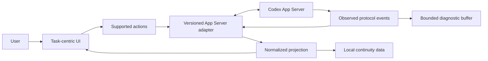

# Architecture Overview

## Architectural boundary

Orbita is a client of the public Codex App Server contract. Codex owns model interaction, conversation state, tool execution, sandbox and approval policy, agent orchestration, and the authoritative execution history. Orbita owns the task-centric user experience, supported user actions, local projections, continuity metadata, and diagnostics.

This boundary is recorded in [ADR 0001](../adr/0001-app-server-boundary.md).

## Confirmed components

The diagram describes responsibilities, not a framework, process topology, database, or IPC choice.

## Responsibility boundaries

### Codex App Server

- Owns threads, turns, agent execution, tools, approvals, sandboxing, and supported runtime controls.
- Exposes versioned requests, responses, notifications, and recoverable history.
- Remains the execution source of truth.

### Versioned adapter

- Uses generated contracts from the pinned runtime where available.
- Validates messages and isolates version-specific behavior.
- Preserves unknown variants for bounded diagnostics without crashing the task workspace.
- Maps only proven source evidence into product-level projections.

### Normalized projection

- Correlates supported root and subagent execution evidence.
- Separates lifecycle, execution status, attention, and provenance.
- Deduplicates replayed events.
- Records gaps and weaker fallback representations when evidence is incomplete.

### Task-centric UI

- Displays the projection, not raw protocol lines.
- Sends only supported actions.
- Never synthesizes agent delegation, execution outcomes, or hidden reasoning.

### Local continuity and diagnostics

- Durable normalized data supports restart and review.
- A bounded raw-event buffer supports diagnosis and protocol evolution.
- Local data never replaces App Server as the authority on what executed.

## Runtime ownership

The product requires safe background continuation when the proven runtime path supports it, explicit warning otherwise, and reconciliation rather than silent replacement after failure.

Whether the implementation uses an embedded child process, a managed daemon, or another public App Server mode is deliberately unresolved. M0 must compare supported behavior for launch ownership, shutdown, reconnect, history, approvals, and versioning before an architecture decision is made.

## Compatibility

- Runtime version and contract capabilities are checked explicitly.
- Unsupported versions fail clearly or degrade through documented capability fallbacks.
- Unknown variants remain diagnostic evidence and do not take down unrelated sessions.
- Protocol field names and method payloads are generated or verified against the pinned runtime, not copied from stale prose.

## Decisions deferred to evidence

M0 must inform, rather than inherit, the choice of:

- desktop framework and IPC mechanism;
- runtime process topology;
- local persistence engine and schema;
- exact status mapping;
- retention limits and compression;
- recovery and migration strategy.

No production stack is canonical until the M0 exit criteria pass.
